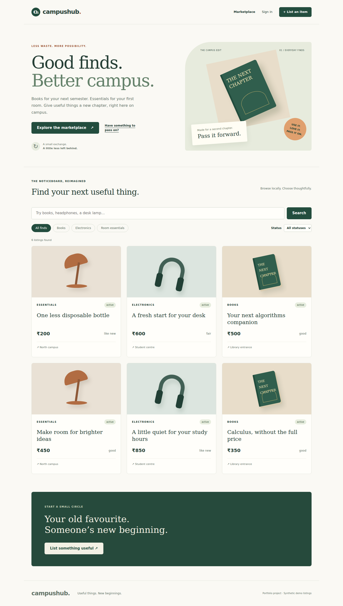

# CampusHub

A campus marketplace portfolio project with a complete listing-management workflow. React handles screens and forms; Express validates requests and checks sessions; MongoDB stores users, opaque sessions, and listings.



## Run the disposable demo

From the repository root, use Node.js 24:

```bash
npm ci
npm run demo
```

Open http://localhost:5173. Use `demo@campushub.example` / `CampusDemo2026!` or register a synthetic account. A real temporary MongoDB process starts locally; its first binary download requires internet. All demo data is removed when the process stops. This mode binds to loopback and must not be exposed publicly.

## Keep local data between runs

1. Start MongoDB 8 locally, or run `docker compose up -d mongo` with Docker installed.
2. Copy the root `.env.example` to `.env` (`cp .env.example .env` on Unix; `Copy-Item .env.example .env` in PowerShell).
3. Set `DEMO_PASSWORD` to a local password of 12–128 characters if you want synthetic seed records.
4. Run `npm run seed`, then `npm run dev`.

The seed command is restricted to the `campushub_demo` database. It adds missing demo records without deleting data or overwriting edits/passwords on existing demo records. Do not point a seed command at production.

| Variable        | Meaning                                                                                            |
| --------------- | -------------------------------------------------------------------------------------------------- |
| `MONGODB_URI`   | Required by persistent server/seed; connection URI for your database                               |
| `CLIENT_ORIGIN` | Exact browser origin, default `http://localhost:5173`; required for every mutation's Origin header |
| `PORT`          | API loopback port, default 4000; adjust the Vite proxy if changing it                              |
| `DEMO_PASSWORD` | Seed-only password for the synthetic account; never used by the disposable demo                    |
| `NODE_ENV`      | `production` enables Secure cookies and requires an HTTPS client origin                            |

Vite proxies `/api` to loopback port 4000. Use **localhost**, as configured, when browsing; a different host or port is a different origin.

## Implemented workflows

- Register, sign in, inspect session, and sign out.
- Browse, search literal title text, filter by category/status, and paginate.
- Create a listing and view its public detail.
- View your own listings and edit only those you own.
- Move active listings to reserved/sold; release reserved listings; keep sold listings terminal.
- Reject stale competing edits with 409 using a version condition in the database write.

Users see safe error messages, empty states, loading feedback, and keyboard-accessible forms. Prices are whole rupees, from 0 to 100,000. Product art is an illustrative CSS drawing, not a photograph of a real item.

## Follow one request

`web/src/pages/ListingForm.jsx` → `web/src/api.js` → `api/src/app.js` → strict schema in `validation.js` → ownership/version check in `listings.js` → MongoDB update → public response → detail page.

See [API contract](../../docs/api-contract.md), [architecture decisions](../../docs/architecture-decisions/001-campus-marketplace.md), and [walkthrough](../../docs/walkthrough.md).

## Checks

`npm test` runs component tests and database-backed API tests. `npm run test:e2e` runs browser journeys against a fresh demo. `npm run build` builds the frontend and both React labs. See the root testing guide for browser installation.

## Deliberate limits

No real orders, buyer contact, messaging, uploads, payments, email verification, password recovery, or campus membership verification. Registration does not prove someone belongs to a campus. Search uses escaped case-insensitive substring matching and may scan titles; it is intended for a small demo catalogue. Offset pagination is bounded and not a large-catalogue strategy. Rate limits are per-process. Multi-document registration/session creation is not transactional: a session-store failure after account creation may require signing in again.

This repository provides local software and deployment guidance, not a hosted marketplace. Do not collect real personal or payment information in the demo.
